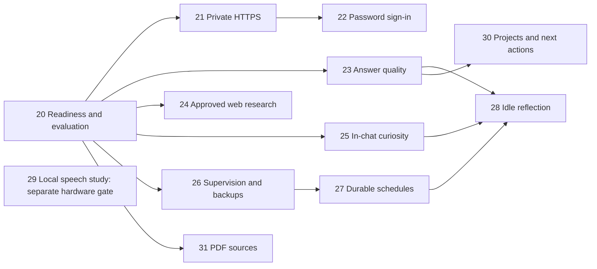

# ADA development roadmap — Phase 20 onward

2026-10-24 Phase32 implementation: [Phase32 — private voice conversations](phase-32-private-voice-conversations.md)
records the user's warm/calm feminine voice and background/locked wake preferences.
It now implements app-owned continuous capture, additive long-form review/recovery,
optional pinned local speech evaluation and explicitly armed Hello Ada with shared
session renewal. Human wake trials missed; target reliability/resource/license
acceptance and phase exit remain open. Source0022/backup-v8, Android27/journal19;
normal builds remain platform speech. See STATUS/WORKLOG and
[usage](../docs/PRIVATE-VOICE-CONVERSATIONS.md). No installed upgrade or deployment.

Subsequent selection, 2026-10-22: Phase31 text-PDF source and19A offline-draft
study/protocol are implemented with actual checks/limits in STATUS/WORKLOG.
Both measured mobile candidates failed reply quality, so local drafting remains
disabled;19A exit is open. OCR and19B integrations remain conditional. Current
0021/backup-v7 and Android25/journal18 are source requirements, not deployment.
See [PDF](../docs/PDF-INGESTION.md) and [draft study](../docs/ON-DEVICE-DRAFTS.md).
Phase31's bounded text-PDF implementation/automated exit is now verified on native
PostgreSQL, real Docker and the S24 FE, with public-sample readability confirmed.
TalkBack/personal-file acceptance remains pending. No subsequent phase was selected
or implemented by this closeout.

Planning proposal, 2026-10-16 America/Phoenix, against source `fa2cbba`.
The user subsequently selected Phase 20; its tooling/non-device baseline is now
implemented and recorded in STATUS. The user subsequently selected Phase21;
its client/configuration/local rehearsal work is implemented with explicit target
limits. Phase22 password/session source and separately authorized private setup
are recorded in STATUS. Phase23 now has locally checked calendar windows,
explicit v5 context upgrade/review controls and a public native comparison; v4
remains default and semantic remains disabled. Phase24 now implements locally
verified, default-off owner-approved public research; installation and physical
target gates remain separate. Phase25 now implements default-off topic/cadence
controls, chat/inbox questions and explicit ordinary answers, with bounded local
verification and separate target/quality gates in STATUS. Phase26 was subsequently
selected: Windows supervision/health/protected backup/recovery source and local
rehearsals are implemented; installation and target gates remain in STATUS.
Phase27 was subsequently selected: reviewed schedules, durable inbox/receipts,
foreground Android polling and aggregate admin controls are implemented locally;
global dispatch and owner consent default off, with no background push. Actual
verification/target limits are in STATUS and
[the guide](../docs/DURABLE-SCHEDULING-AND-REMINDERS.md).
Phase28 was selected: bounded idle reports/question drafts, owner review and
recovery are implemented; summaries remain disabled pending separate evidence.
[The reflection guide](../docs/IDLE-REFLECTION-AND-DREAM-REVIEW.md) records boundaries.
Phase29 was selected: study/interface, strict local metadata/byte checks and
platform preview are implemented; additional runtime/model activation awaits
license/compatibility and physical evidence. See
[the speech guide](../docs/NATURAL-LOCAL-SPEECH.md).
Phase30 was selected: explicit owner/scoped work, exact chat Save review, balanced
selected-work briefs and optional consented follow-ups/reminders are implemented
and locally verified. See [the guide](../docs/PROJECTS-AND-FOLLOW-THROUGH.md) and
STATUS/WORKLOG for actual checks and remaining human/physical usefulness gates.
**Phase31 remains proposed. This roadmap does not authorize its implementation
or any deployment.**
This review excludes physical-Android verification and iOS work. Their existing
gates remain open; they are not prerequisites for independent server, emulator,
web or planning work. Optional on-device voice is designed here, with its later
hardware activation gate stated separately. No live database was queried.

## Direction

Make ADA easier to reach and sign into, better at using what the owner has told
it, capable of approved public research, and more conversational. Then add
reliable unattended operation and bounded background reflection. Evaluate speech
models as speech models; do not assume a small text LLM fixes audio quality.

Use the existing private memory, source versions, reviewed proposals, episodes,
streaming, credentials and erasure. A larger model, more agents or more stored
text is not itself evidence of a better assistant. Measure useful outcomes.

Confirmed user choices on 2026-10-16: keep the existing Windows laptop plugged in
and awake initially; support all three curiosity channels (active chat, a later
inbox, occasional initiated conversations/notifications). Deliver in-chat/inbox
first, then scheduled notices with Phase 27. Personal topics are permitted, with topic
controls and an easy skip. Everyday task priorities remain a provisional mix of
remembering life/projects, grounded research and follow-up pending further input.
These are planning choices, not consent to enable live schedules or notifications.

## Recommended phases

| Phase | Plan | Concrete result | Actual dependencies |
|---|---|---|---|
| 20 | [Release readiness and quality baseline](phase-20-release-readiness-and-quality-baseline.md) | Implemented: legacy recovery, explicit inventory policy, saved scorecard and locally checked readiness; limits in STATUS | Source through Phase 18; physical 17-A gates excluded |
| 21 | [Private-network connectivity](phase-21-private-network-connectivity.md) | Implemented client profiles/preflight/diagnostics and private-route templates; local rehearsals, actual enrollment/release HTTPS deferred | 20 transport audit; 18 authentication |
| 22 | [Password login and sessions](phase-22-password-login-and-sessions.md) | Implemented: password/session source and isolated checks; live enrollment/installation and target gates separate | 20; 21 before remote use |
| 23 | [Answer quality and memory relevance](phase-23-answer-quality-and-memory-relevance.md) | Implemented: explicit windows/review, measured optional v5 with regressions recorded; v4 default/semantic disabled | 20; existing 08–15 |
| 24 | [Secure web research](phase-24-secure-web-research.md) | Implemented default-off: isolated approved Python/Wikipedia pilot, saved W evidence and Android recovery; target limits in STATUS | 20, 12, 18; 21/22 for remote UX |
| 25 | [Conversational curiosity](phase-25-conversational-curiosity.md) | Implemented opt-in: bounded chat/inbox questions, inspectable original pins and exact opening/answer recovery; no auto-memory or scheduler | 20, 14/15; 23 preferred; no scheduler required |
| 26 | [Always-on operations and recovery](phase-26-always-on-operations-and-recovery.md) | Source and four-hour isolated development soak passed after sharing/startup fixes; installation, reboot/sleep, 24-hour and representative recovery gates remain in STATUS | 20; 21 for remote reachability; 18 |
| 27 | [Durable scheduling and reminders](phase-27-durable-scheduling-and-reminders.md) | Implemented source: previewed finite timezone schedules, durable inbox/receipts and foreground polling; default off/no push, target limits in STATUS | 26 development gate passed; 13/18 and22 source present; installed-host gates separate |
| 28 | [Idle reflection and dream review](phase-28-idle-reflection-and-dream-review.md) | Implemented initial reports/question drafts and owner review; summaries disabled, checks/limits in STATUS | 23, 25, 26, 27 |
| 29 | [Natural local speech](phase-29-natural-local-speech.md) | Study/interface and platform preview implemented; new model/runtime unselected and activation pending | 17/17-A source; actual voice activation awaits device/license evidence |
| 30 | [Projects and personal follow-through](phase-30-projects-and-personal-follow-through.md) | Reviewed goals, next actions and a useful daily brief | 23; 27 only for reminders; 28 optional |
| 31 | [PDF ingestion and document expansion](phase-31-pdf-ingestion-and-document-expansion.md) | Citable text PDFs first; separately gated OCR when justified | 08, 20; 23 for quality scoring |

Numbers are stable identifiers, not a mandatory serial build. After Phase 20, 21/22 make
daily access easier; 23/24/25 improve usefulness. Phase 26 can move forward immediately
after Phase 20 if uptime is the priority. Phase 29 design does not delay any server feature.
30/31 are additional proposals; choose them if their benefit matches actual use.
No dates or hardware purchases are promised before measurements and user choice.

## Decisions that change the original gap proposals

1. **Separate source from installation.** Current source head is0016 after Phase22;0015 was the Phase20/21 source baseline. 0005 is a
   historical observation, not a fresh live result.0005 already includes Phase 08
   document ingestion. No current live failure is inferred from an old record.
2. **Fix the upgrade safety prerequisite.** `operations.backup` and `unpack`
   require 0015. F-0 cannot use that tool unchanged to protect 0005 before upgrading.
   Phase 20 must rehearse an encrypted legacy backup/restore path first. Installing
   the live system remains separately selected scope, not a condition for writing
   or testing features on disposable current schemas.
3. **Keep the backend on loopback.** Use a private HTTPS proxy. Android already
   accepts valid HTTPS origins; arbitrary LAN cleartext and a public API bind are
   unnecessary. Tailscale network identity does not replace ADA account login.
4. **Password is the sign-in experience.** Sessions still use unpredictable
   credentials internally. Existing CLI/device tokens remain compatible during
   migration; they leave normal login screens. No public signup or automatic admin.
5. **Measure before changing retrieval/model defaults.** Five existing evaluation
   scripts are useful starting points. Add a shared representative scorecard,
   compare lexical/hybrid and context choices, then enable only useful changes.
6. **Research explicitly discloses something.** Search providers learn approved
   queries; websites learn requested URLs and network metadata. Keep private chat
   and memory local by default, preview outgoing text, and enforce network controls
   outside the LLM. An absolute zero-disclosure promise would be false.
7. **Curiosity starts during chat.** A general getting-to-know-you question needs
   no prior evidence. A question asserting something about the owner does. Asking
   is not remembering; answering is not blanket consent for future private profiling.
8. **Dreaming means bounded artifact generation.** Reuse Phase 13's explicit background
   jobs behind new consent/scheduling, rather than treating existing workers as
   nonexistent. No retraining, consciousness claim, hidden reasoning archive,
   automatic factual promotion or idle web browsing is implied.
9. **Retain the selected retention policy.** Source content stays until explicit
   owner deletion. Backup pruning is a different opt-in policy, initially off.
   A backup on the same disk is not protection against losing the laptop.
10. **Use speech-specific models.** Offline ASR and neural TTS are the core voice
    candidates; optional text polishing cannot silently rewrite original ASR or
    completed answers. No new model/runtime is selected without license and
    quality/resource evaluation.

## Rules shared by every new phase

All phase interfaces below are **proposed**, not exported endpoints or runnable
commands. Re-read the actual head when implementing: add after that head, never
reserve migration numbers now or edit released history. Follow AGENTS/STANDARDS,
start with invariants/failure tests, and select one phase/checkpoint at a time.

Any new table, private blob or cache must enter the erasure dependency inventory,
privacy-epoch invalidation and backup/restore manifest. Security metadata needs a
separate minimal-retention classification. Current45-content-table/54-total-table
counts describe 0015, not permanent constants. Version backup schemas explicitly;
test both old artifact recovery and populated upgrades. Restore must quarantine
new session/refresh/schedule authority as well as legacy/device credentials.

Every background action has owner, scope, consent/version, cancellation fence,
data epoch and durable receipt. Recheck these before private reads, publication
and any outbound request. Define what happens when its originating device is
revoked, a session expires, consent changes, sources are deleted or backups restore.
Keep one inference admission budget and one Uvicorn worker. No external inference
inside database transactions; no invisible extra GPU worker.

Preserve exact IDs, source trust/spans, old prompts and completed replay, except
the implemented explicit-erasure tombstone policy. New prompt/retrieval versions
are opt-in and audited for existing conversations. Model suggestions never grant
permissions, approve memory or supply their own factual evidence.

Each implementation must pass relevant backend/PostgreSQL/client checks and its
phase's failure matrix, record actual runs/skips, and distinguish synthetic,
real-model and target evidence. Physical/iOS gates stay deferred in this review.
Browser keyboard/accessibility, server HTTPS, host performance and emulator checks
remain in scope for future validation. Deployment is never implied by a plan.

## Success scorecard

Start with a small public/synthetic corpus and owner-chosen tasks. Measure useful
task completion, retrieval recall/MRR, citation entailment, justified uncertainty,
correction success, time to useful answer and follow-up helpfulness. Include
negative/ambiguous/deleted/cross-owner cases; isolation and authorization failures
must be zero in the test corpus. Freeze a held-out set and publish aggregate
regressions locally. Private evaluation requires separate opt-in and no raw-text
exports. Model grading alone cannot validate provenance or authorization.

Proposed initial operational objectives: daily encrypted backup, alert after 26 h
without a verified artifact, four-hour local soak followed by a24h trial, and a
foreground latency budget measured against the Phase 20 baseline. These are targets
to test, not current performance claims. Choose backup cadence/RPO and recovery
time objectives from measured data size and acceptable loss before live use.

## Scope parked for later

Physical phone/audio/accessory/battery verification and iOS are excluded as asked.
Shared scopes, arbitrary shell/filesystem access, autonomous external writes,
calendar/email/cloud connectors, multiworker scale-out and model fine-tuning are
not needed to deliver these initial benefits. Revisit one with a concrete use
case. Phase 19 remains conditional; 20–31 refine selected ideas without renumbering
19, claiming it complete or requiring its unrelated options.

## Evidence and references

Source inspected: `auth.py`, `security.py`, `security_gate.py`, `operations.py`,
`inventory.py`, `agents.py`, `tools.py`, `consolidation.py`, `api.py`, config,
source clients and tests. OpenAPI has 96 paths/132 schemas; 15 migration files;
head 0015. Existing checks in STATUS are historical, not rerun by this review.
See [the gap review](GAPS-AND-FUTURE-PLANS.md) for corrections and added G-30 onward.
Primary technical references and dated research are in [SOURCES](SOURCES.md).
